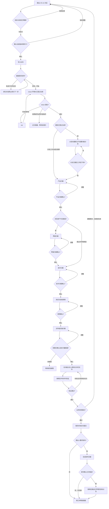

# Business Agent

一套与具体业务、公司基建无关的 **任务型编码 Agent** 架构。把本目录交给任意业务的 AI，按 [实例化协议](docs/12-instantiation-protocol.md) 读取后，可以搭出该业务自己的 Agent。

本仓库只保留架构与设计。它不包含某一家公司的仓库地址、身份系统、制品平台、模型供应商或业务规则，也不能直接当成某个业务的运行中工作台。

## 它解决什么

业务侧的改动往往持续数小时到数天：要澄清目标、确认方案、改已登记的代码仓库、验证、验收，并在关键点由人拍板。聊天窗口关了任务就停，即时通讯里又容易长出第二套状态机。

本架构把这件事做成 **一条可关闭页面再打开的任务**：

- 业务用自然语言描述目标，不必先选仓库或模型。
- 目标明确并确认后，才进入队列；同一时刻只处理一条进行中的任务。
- 方案、界面、技术、用例、文件级实施计划分别确认；未确认不得改业务代码。
- 真正改仓库、切分支、提交、发布的只有 Kernel 命令。
- 浏览器是遥控器。任务状态在工作台文件里，关闭页面后仍可恢复。

## 流程

问候和咨询停在对话里，不建任务。确认的是当前版本需求卡；上游一变，下游确认作废，从产品方案重走。开发只使用最新确认的快照。

## 读本仓库的顺序

给实施 AI 的规则在 [`AGENTS.md`](AGENTS.md)。设计正文按下面顺序读：

1. [问题与产品](docs/01-problem-and-product.md)
2. [架构](docs/02-architecture.md)
3. [内核不变量](docs/03-kernel-invariants.md)
4. [工作流与闸门](docs/04-workflow-and-gates.md)
5. [上下游对齐](docs/05-alignment.md)
6. [状态与文件](docs/06-state-and-files.md)
7. [编码运行时](docs/07-coding-runtime.md)
8. [通道与界面](docs/08-channels-and-product.md)
9. [验证、预览与验收](docs/09-verification-acceptance.md)
10. [安全与可观测](docs/10-safety-and-observability.md)
11. [业务绑定合同](docs/11-binding-contract.md)
12. [实例化协议](docs/12-instantiation-protocol.md)
13. [模块与命令合同](docs/13-module-and-command-contract.md)
14. [已锁定决策](docs/14-decisions.md)
15. [术语](docs/15-glossary.md)

填空产物在 [`blueprint/`](blueprint/)。机器可读结构在 [`contract/`](contract/)。虚构书店示例只说明绑定长什么样，见 [`examples/bookstore/`](examples/bookstore/README.md)。可直接粘贴给实施 AI 的开工说明在 [`prompts/instantiate.md`](prompts/instantiate.md)。

## 实例边界

每个实例只服务 **一个业务、一组已登记仓库**。模式本身不绑定行业；实例的范围由该业务的绑定合同决定。未登记的仓库、未配置的验证命令、未确认的方案，都不会被 Agent 补做。

## 非目标

- 不提供开箱即跑的某一业务工作台。
- 不替代该业务既有的发布系统。
- 不把业务源码放进 Agent 仓库。
- 不在即时通讯适配器里实现第二套任务状态机。
